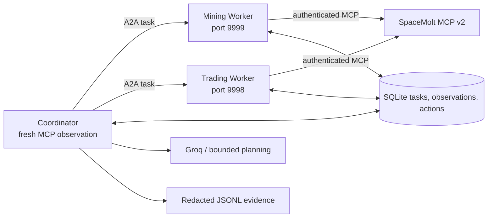

# FAST-NUCES SpaceMolt MAS

## 1. Setup

```cmd
cd /d C:\MAS\SpaceMolt_MAS_Starter
py -3.11 -m venv .venv
.venv\Scripts\activate
python -m pip install --upgrade pip
python -m pip install -r requirements.txt
python -m pip check
python -m scripts.verify_local
python scripts\preflight.py
python examples\mcp_discover.py
```

Register exactly two fresh pilots and replace the names below with the assigned group ID:

```cmd
python examples\pilot_setup.py register --username AI26-G01-A --empire nebula
python examples\pilot_setup.py register --username AI26-G01-B --empire nebula
```

Never paste registration codes or pilot passwords into source, logs, or reports. The setup helper stores passwords in Windows Credential Manager.

## 2. Architecture

- **Coordinator:** `mas/coordinator.py` reads fresh MCP state, creates durable SQLite tasks, delegates work, and records outcomes.
- **Mining acquisition agent:** `examples/a2a_worker.py --role mining` runs as an independent A2A service on port 9999.
- **Trading/logistics agent:** the same worker implementation runs with `--role trading` on port 9998.
- **MCP client:** `mas/mcp_client.py` discovers live schemas, authenticates, validates arguments, re-authenticates after expiry, and records sanitized evidence.
- **Memory:** `logs/mas.sqlite3` stores tasks, observations, actions, results, and idempotency keys.
- **LLM/accounting:** the supplied Groq example and `scripts/budget.py` provide optional bounded planning and usage accounting.
- **Baseline:** `mas/baseline.py` is a deterministic single-script status loop used for the required comparison.



## 3. Run independent A2A services

Open one terminal for each pilot/role:

```cmd
python examples\a2a_worker.py --role mining --pilot AI26-G01-A --port 9999
python examples\a2a_worker.py --role trading --pilot AI26-G01-B --port 9998
```

Observe both services without mutating the game:

```cmd
python examples\a2a_client.py --url http://127.0.0.1:9999 --pilot AI26-G01-A --objective observe --dry-run
python examples\a2a_client.py --url http://127.0.0.1:9998 --pilot AI26-G01-B --objective assess --dry-run
```

## 4. Run the coordinator

Observation only:

```cmd
python -m mas.coordinator --pilots AI26-G01-A AI26-G01-B --objective observe_mining
python -m mas.coordinator --pilots AI26-G01-A AI26-G01-B --objective assess
```

For the beginner Iron Supply Run, first inspect the live mission board. Accepting a
mission changes game state, so this command requires explicit confirmation:

```cmd
python -m mas.coordinator --pilots AI26-G01-A --objective accept_mission --mission-id iron_supply_run --confirm
```

This only accepts the mission; it does not travel or mine.

To run an already-active Iron Supply Run, pass its active mission ID shown by
`get_active_missions`. The runner checks the pilot's location, fuel, cargo
capacity, and mission progress before acting; it requires `--confirm`, mines
only until the 30-unit goal, searches unvisited same-empire systems up to three
jumps away for fresh Iron Ore when mining stalls or the local deposit is
exhausted, preserves a return-fuel reserve, returns to Grand Exchange, docks,
and verifies turn-in. The coordinator waits up to one hour for the mission
worker to finish:

```cmd
python -m mas.coordinator --pilots AI26-G01-A --objective run_mission --mission-id <active-mission-id> --confirm
```

State-changing operations require explicit consent at the command line:

```cmd
python -m mas.coordinator --pilots AI26-G01-A --objective mine --confirm
python -m mas.coordinator --pilots AI26-G01-B --objective buy --confirm
```

`buy` and `sell` are intentionally not delegated with item and quantity values unless the coordinator payload is extended for a specific live mission. This prevents an uninformed market action.

## 5. Safety and recovery

- State-changing calls require `--confirm` and a worker `confirm_state_change` flag.
- Completed action keys are not replayed.
- MCP login is repeated for each operation batch; a multi-step mission keeps one
  authenticated session open to reduce connection churn.
- MCP server errors retain their code and message in redacted evidence; ambiguous
  state-changing calls are not blindly retried.
- Travel aborts are not retried blindly; get fresh status before the next action.
- Movement and mutation payloads are filtered through live MCP schemas.
- Workers bind to one pilot and reject tasks for a different pilot.
- Restart workers or the coordinator and use the persisted task/action tables. Pending tasks remain visible in SQLite.
- Never manually run gameplay and represent it as autonomous.

## 6. Assessed session controls

```cmd
python -m scripts.runtime start
python -m scripts.runtime stop
python -m scripts.runtime status
python -m scripts.budget
```

The optional Groq planner is bounded by `scripts/budget.py`. The system never fabricates a successful API or MCP call.

## 7. Baseline comparison

```cmd
python -m mas.baseline --pilot AI26-G01-A --cycles 3
```

The baseline is a deterministic status loop. It has no independent roles, MCP-state planning, A2A delegation, persistent action recovery, or autonomous market/mine objective selection.

## 8. Submission evidence

Use `logs/events.jsonl` and `logs/mas.sqlite3`, plus the public profiles:

- `https://spacemolt.com/player/AI26-G01-A`
- `https://spacemolt.com/player/AI26-G01-B`

Before submission, sanitize credentials and add a concise completed copy of `REPORT_TEMPLATE.md`.
